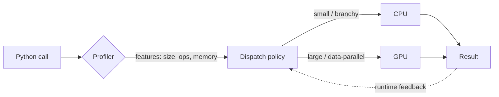
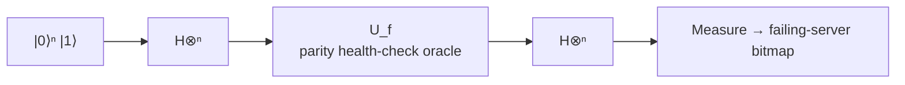

<picture>
  <source media="(prefers-color-scheme: dark)" srcset="assets/banner-dark.svg">
  
</picture>

 

---

### `$ cat about.md`

I'm an M.Tech CSE student at **Manipal Institute of Technology, Bengaluru**, working where software meets hardware: figuring out *where* a workload should run, CPU or GPU, and *how* to run it there fast. On the side I'm learning quantum computing the hands-on way, with Qiskit.

I also run **[LYPTRON](https://lyptron.com)**, a design and technology studio, where I've shipped production apps for real clients, from a desktop music-notation editor to a Flutter field-operations app.

<table>
<tr>
<td width="33%" valign="top">

**🔭 Researching** 
Intelligent CPU–GPU execution strategy selection for ML workloads

</td>
<td width="33%" valign="top">

**⚛️ Learning** 
Quantum algorithms (Bernstein–Vazirani, oracles, circuit design)

</td>
<td width="33%" valign="top">

**🛠️ Building** 
Client products and agentic workflows at LYPTRON

</td>
</tr>
</table>

---

### `$ ls ~/work` · click a project to open it

<b>⚡ AutoHetero</b> · a zero-config runtime that dispatches Python workloads to CPU or GPU

 

A self-adaptive runtime layer that sits under ordinary Python code, profiles each workload, and dispatches it to the CPU or the GPU, so developers get heterogeneous execution without rewriting anything.

`Python` `CUDA` `profiling` `HPC`

<b>🧠 Intelligent Execution Strategy Selection</b> · M.Tech research: choose device and GPU concurrency for ML models

 

My M.Tech HPC project. Given an ML workload, it picks the execution strategy: which device it runs on and how much GPU concurrency to use. The aim is a decider students can use before they run their models. It builds on what AutoHetero showed in practice.

`Python` `CUDA` `ML systems` `research`

<b>⚛️ ClusterDoc</b> · finds failing servers in a cluster with the Bernstein–Vazirani algorithm

 

Each server's health becomes one bit of a hidden string. A parity health-check oracle encodes the cluster, and one Bernstein–Vazirani query recovers which servers are failing. A classical approach needs *n* checks for the same answer.

`Qiskit` `Python` `quantum algorithms`

<b>🛰️ EGAQ</b> · entropy-guided adaptive quadtree for multi-resolution satellite image retrieval

 

Splits satellite imagery into a quadtree that subdivides only where image entropy is high, so detailed regions get fine tiles and flat regions stay coarse. Retrieval works across resolutions without indexing every pixel at full detail.

`Python` `computer vision` `spatial indexing`

<b>💼 Client work at LYPTRON</b> · production apps, end to end

 

- **Music-notation desktop app**: offline score editor with playback, tala-aware layout, and PDF export, shipped as a Windows installer
- **Field-operations app** (Flutter): attendance, materials and reporting for construction sites, designed for non-technical users
- Client websites and landing pages, from design system to deployment

Code is private under client agreements; happy to walk through the architecture.

---

### `$ stack --list`

<table>
<tr><td><b>Languages</b></td><td></td></tr>
<tr><td><b>HPC &amp; Quantum</b></td><td>

</td></tr>
<tr><td><b>System Design</b></td><td>

</td></tr>
<tr><td><b>Agentic AI &amp; Automation</b></td><td>

</td></tr>
<tr><td><b>Backend &amp; Apps</b></td><td></td></tr>
<tr><td><b>Tools</b></td><td></td></tr>
</table>

---

### `$ git log --graph`

<picture>
  <source media="(prefers-color-scheme: dark)" srcset="https://raw.githubusercontent.com/VARITHSA/VARITHSA/output/snake-dark.svg">
  
</picture>

---

### `$ ./visitor.sh` · pick your path

🧑‍💼 <b>I'm hiring</b>

 

I'm looking for **SDE roles** where systems thinking matters: backend, infrastructure, performance, ML systems, or agentic AI. I bring:

- Low-level performance work (CUDA, MPI, OpenMP) **and** end-to-end product delivery
- Experience owning projects with real clients, from scoping and contracts to design and shipping
- Steady DSA practice

📫 [Email me](mailto:bssrivathsa2003@gmail.com) or [connect on LinkedIn](https://linkedin.com/in/srivathsa-b-s-185a03237).

🔬 <b>I want to collaborate on research</b>

 

I'm interested in heterogeneous scheduling, GPU performance modelling, energy-aware execution, and practical quantum algorithms. If you're working on any of these, [open a discussion](https://github.com/VARITHSA/VARITHSA/issues/new?title=Research%20collab%3A%20&body=Hi%20Srivathsa%2C%20I%27m%20working%20on%20...) and tell me about it.

🏢 <b>I need something built</b>

 

That's what [LYPTRON](https://lyptron.com) does: apps, websites, and design systems, built with care. 
*Building trust, one partnership at a time.*

 

Both buttons open a pre-filled GitHub issue. I read every one.

